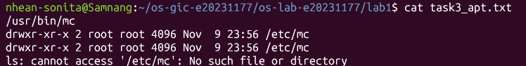
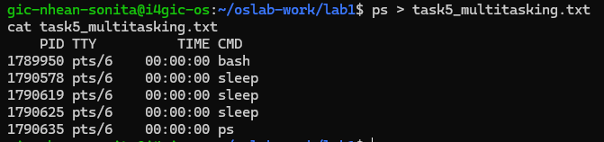

# OS Lab 1 Submission

- **Student Name:** Nhean Sonita
- **Student ID:** e20231177
- **Ubuntu username on the server:** gic-nhean-sonita
- **My values** (`oslab values lab1`): file1 = `lemon`, file2 = `silver`, count = `2`

---

## Task 1: Operating System Identification

The system is running Ubuntu. I used `uname -a` to identify the Linux kernel information and `lsb_release -a` to identify the Ubuntu distribution.

- **Kernel version:** [Fill in from `task1_os_info.txt`]
- **Ubuntu version:** [Fill in from `task1_os_info.txt`]

---

## Task 2: Essential Linux File and Directory Commands

I practised creating, copying, renaming and deleting files using basic Linux commands.

I created `lemon.txt` and `silver.txt`, wrote text into both files, copied the first file, renamed the second file to `silver_renamed.txt`, and deleted the copy.

The last `ls` showed:

- `lemon.txt`
- `silver_renamed.txt`

This helped me understand how to manage files and directories using the terminal.

---

## Task 3: Package Management Using APT

I installed Midnight Commander (`mc`) and checked its program location and configuration directory.

After using `apt-get remove`, the program was uninstalled, but its configuration directory `/etc/mc` remained.

After using `apt-get purge`, the configuration directory was also deleted. The final command returned `No such file or directory`, confirming that the directory no longer existed.

---

## Task 4: Programs vs Processes

I used `which sleep` to find the location of the `sleep` program and ran `sleep 30 &` to start it in the background.

I used `ps` to check the running processes.

A **program** is an executable file stored on disk, while a **process** is an instance of a program that is currently running.

- **Before:** [Describe what `ps` showed before starting sleep.]
- **During:** [Describe the sleep process shown in `ps`.]
- **After:** [Describe what happened after 30 seconds.]

The program file remains on disk even after its running process finishes.

---

## Task 5: Multitasking

I started two copies of the `sleep` program in the background using `sleep 300 &`.

I then used `ps` to check the running processes. It showed two `sleep` processes running at the same time.

This demonstrates that an operating system can manage multiple processes simultaneously.

However, this does not show exactly how the processor shares its time between processes because the `sleep` command waits without actively using the CPU.

---

## Task 6: Virtualization and Hypervisor Detection

[State whether the system is running on a virtual machine or physical hardware based on the output of `systemd-detect-virt`.]

The commands used were `systemd
